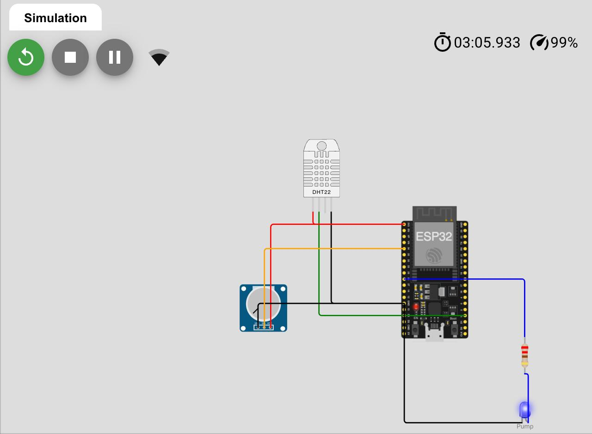

# IoT-Based Smart Agriculture Monitoring System

## Objective
Develop a smart agriculture monitoring system using an ESP32 and IoT sensors that tracks temperature, humidity and soil moisture, and automates irrigation.

## Hardware / Software
- ESP32 DevKit (simulated on Wokwi)
- DHT22 temperature and humidity sensor
- Soil moisture sensor (simulated with a potentiometer)
- LED representing the irrigation pump
- WiFi cloud upload to ThingSpeak (optional, API key needed)
- Wokwi simulator, DHT sensor library

## Pin Mapping
| Component | ESP32 Pin |
|-----------|-----------|
| DHT22 data | GPIO 15 |
| Soil moisture (analog) | GPIO 34 |
| Pump (LED) | GPIO 26 |

## Workflow
1. Temperature, humidity and soil moisture are read every second.
2. If soil moisture drops below 30%, the pump turns ON.
3. The pump turns OFF when moisture rises above 50% (hysteresis avoids rapid switching).
4. Irrigation cycles are counted and all readings are printed to the Serial Monitor.
5. Every 20 seconds the data is sent to the cloud (ThingSpeak) when WiFi and an API key are available.

## Testing Analysis
- Soil below 30%: pump ON, cycle counter increases.
- Soil above 50%: pump OFF.
- Temperature and humidity were varied with the DHT22 sliders and the readings updated correctly.

## How to Run
1. Open Wokwi and create a new ESP32 project.
2. Paste `circuit/diagram.json` and `code/sketch.ino`.
3. Add the DHT sensor library and start the simulation.

## Folder Structure
- `code/` - source code
- `circuit/` - circuit diagram file

## Output

## Experience and Suggestions
Good practice with sensor integration, automation logic and IoT cloud concepts.
